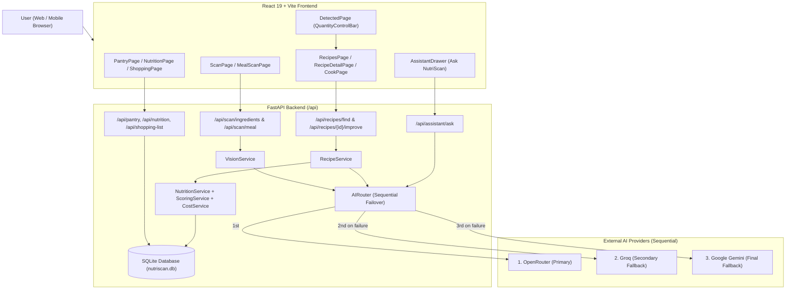

# 🥗 NutriScan — AI Kitchen Copilot & Nutrition Engine

> **"Most recipe apps ask what you want to eat. NutriScan asks what you already have."**  
> **Tagline:** *Scan it. Cook it. Understand it.*

[](https://fastapi.tiangolo.com/)
[](https://react.dev/)
[](https://tailwindcss.com/)
[](https://www.sqlite.org/)
[](#%EF%B8%8F-sequential-3-provider-ai-failover-architecture)

**NutriScan AI Copilot** is a full-stack multimodal kitchen intelligence and nutrition platform. Upload or snap a photo of raw kitchen ingredients or a prepared meal—NutriScan identifies every visible ingredient with estimated quantities, generates custom AI recipes on the fly, matches recipes against your kitchen & pantry inventory, calculates deterministic per-serving nutrition and costs, optimizes meal health scores in one click, and guides you through distraction-free step-by-step cooking.

---

## 📑 Table of Contents

1. [Key Features](#-key-features)
2. [Sequential 3-Provider AI Failover Architecture](#️-sequential-3-provider-ai-failover-architecture)
3. [System Architecture & Data Flow](#️-system-architecture--data-flow)
4. [Tech Stack](#-tech-stack)
5. [Project Structure](#-project-structure)
6. [Getting Started (Local Development)](#-getting-started-local-development)
7. [Environment Variables Configuration](#-environment-variables-configuration)
8. [API Reference](#-api-reference)
9. [Testing & Verification](#-testing--verification)
10. [Deployment Guide (Vercel / Render)](#-deployment-guide-vercel--render)
11. [Security & Disclaimers](#️-security--disclaimers)

---

## 🌟 Key Features

### 1. 📸 Multimodal Vision Ingredient Scanner (`/scan`)
- Upload or capture a photo of raw ingredients (`JPG`, `JPEG`, `PNG`, `WEBP` up to 10 MB).
- Uses an open-world multimodal vision prompt across the **Sequential 3-Provider AI Failover Stack** (`OpenRouter → Groq → Google Gemini`) to detect every visible edible ingredient, normalize names, estimate quantities (`g`, `ml`, `pcs`, `tbsp`, `tsp`), and report confidence scores.
- Falls back gracefully to `DemoVisionProvider` if all external providers are unreachable.

### 2. ⚖️ Interactive Quantity Confirmation (`/detected`)
- Displays AI-detected ingredients with confidence badges (`97% confidence`) and visual food icons.
- Includes the interactive **`QuantityControlBar`** with drag sliders, `[-]` / `[+]` steppers, unit switchers (`g`, `ml`, `pcs`, `tbsp`, `tsp`), and quick preset chips.
- Allows adding extra manual ingredients before matching recipes.

### 3. 🍳 Smart Recipe Recommendation & AI Chef Engine (`/recipes`)
- **Prioritized Scanned Ingredient Matching**: Ranks recipes by how many of your directly scanned ingredients they use, boosted further when recipes use expiring `"Use Soon"` pantry items.
- **Dynamic Custom AI Recipe Generation**: When you scan a new combination of ingredients, NutriScan's AI Chef invents a custom, healthy recipe centered around your exact ingredients, persists it to SQLite (`recipes` & `recipe_ingredients` tables), caches it for instant filter toggling, and pins it to the top of your recommendations.
- **Instant Multi-Filter Controls**:
  - Filter pills: `⚡ Under 20 min`, `💪 High Protein`, `💰 Budget Friendly`, `🌱 Vegetarian`, `🌿 Vegan`, `🌾 High Fiber`, `🔥 Low Calorie`.
  - Budget tier selector: `All Budgets`, `Under ₹75`, `Under ₹100`, `Under ₹150`.
  - Real-time search by recipe title or dietary tag.

### 4. 📊 Deterministic Nutrition & Cost Engine (`/recipe-detail`)
- Calculates per-serving and total recipe macros (**Calories, Protein, Carbs, Fat, Fiber**) deterministically from per-100g benchmark values in SQLite (`IngredientDB`).
- Automatically registers newly discovered ingredients into `IngredientDB`.
- Dynamic **Serving Scaler** (`1` to `8+` servings) scales required ingredient quantities, macro totals, and estimated cost (`₹/serving` and total `₹`) in real time.
- Interactive **Recharts** macro breakdown visualization and **NutriScore** health badge (`0–100`).

### 5. ✨ "Improve My Meal" Optimizer (`/api/recipes/{id}/improve`)
- One-click meal health optimizer that:
  - Cuts cooking oil/butter by 50%
  - Adds fresh leafy greens (`+100g spinach` for iron & fiber)
  - Boosts clean plant protein (`+80g boiled chickpeas`)
  - Applies healthier ingredient swaps (e.g., `Paneer → Tofu`)
- Displays side-by-side **Original vs. Improved** nutrition macros, percentage deltas, and recalculated NutriScore.

### 6. 🍽️ Prepared Meal Scanner (`/scan-meal`)
- Upload a photo of a cooked dish (e.g., *Chicken Biryani*, *Paneer Butter Masala*, *Avocado Toast*).
- Vision AI identifies the dish name, estimates visible portion weight (`~350g`), confidence, and macro breakdown, with one-click logging to your daily nutrition tracker.

### 7. ♻️ Smart Pantry & Food Waste Reduction (`/pantry`)
- Full CRUD inventory tracking with freshness states: `Fresh`, `Use Soon`, and `Expiring Soon`.
- Recipes that utilize `Use Soon` or `Expiring Soon` pantry items receive an automatic ranking boost to reduce household food waste.

### 8. 📈 Daily Nutrition Tracker & Meal Log (`/nutrition`)
- Tracks cumulative daily intake against configurable macro targets (`Calories`, `Protein`, `Carbs`, `Fat`, `Fiber`) with progress bars and a timestamped meal timeline.

### 9. 🛒 Missing Ingredients & Shopping List (`/shopping`)
- One-click batch export of missing recipe ingredients into your persistent shopping list with check/uncheck purchased states.

### 10. 👨‍🍳 Interactive Step-by-Step Cooking Mode (`/cook`) & AI Kitchen Assistant
- Distraction-free step-by-step cooking view with progress bar (`STEP X OF Y`).
- Context-aware **Ask NutriScan** side drawer (`AssistantDrawer.jsx`) that knows your active recipe and available ingredients to answer culinary, substitution, and prep questions.

---

## 🛡️ Sequential 3-Provider AI Failover Architecture

All AI-powered features in NutriScan route through [`AIRouter`](backend/services/ai_router.py), which enforces a **strictly sequential fallback order**:

```text
Request Input (Text Prompt or Image Bytes + MIME Type + Schema Validator)
   │
   ├─► 0. Pre-Flight Request Validation (_validate_request)
   │      • Rejects empty prompts, empty image bytes, or invalid MIME types immediately
   │        without wasting any provider API calls.
   │
   ├─► 1. OpenRouter (Primary) — openrouter/free
   │      • Multimodal Vision (OpenAI data-URL format) + Text/JSON generation
   │      • If valid & passes schema validation ──► Return immediately (Groq & Gemini NOT called)
   │      • On error / timeout / 429 / empty / malformed JSON ──► Fall back to #2
   │
   ├─► 2. Groq (Secondary Fallback) — qwen/qwen3.8-27b
   │      • High-speed Multimodal Vision + Text/JSON generation (with OTPM token guard)
   │      • Checks vision model compatibility before sending image payloads
   │      • If valid & passes schema validation ──► Return immediately (Gemini NOT called)
   │      • On error / timeout / 429 / empty / malformed JSON ──► Fall back to #3
   │
   └─► 3. Google Gemini (Final Fallback) — gemini-3.8-flash
          • Native Gemini REST API (inline_data base64 vision + responseMimeType: application/json)
          • If valid & passes schema validation ──► Return response
          • If all 3 fail ──► Log sanitized errors ([REDACTED] keys) & trigger graceful fallback
```

### Key Reliability Guarantees
- **Never Calls Providers Simultaneously**: Requests are strictly sequential (`OpenRouter → Groq → Gemini`).
- **In-Loop Response & Schema Validation**: JSON parsing and feature-specific schema validation (verifying `ingredients` list, `meal` object, or `recipe` structure) happen **inside** each provider attempt so malformed or empty JSON automatically triggers fallback to the next provider.
- **Zero Key Leakage**: API keys are read exclusively from backend environment variables and scrubbed from all logs and exception messages via [`_sanitize_error()`](backend/services/ai_router.py).

---

## 🏗️ System Architecture & Data Flow



---

## 💻 Tech Stack

| Layer | Technology |
| :--- | :--- |
| **Frontend** | React 19, Vite 8, Tailwind CSS 4, Recharts, Lucide React Icons |
| **Backend** | Python 3.10+, FastAPI, Uvicorn, Pydantic v2, Requests, Pillow |
| **Database** | SQLite (`nutriscan.db`), SQLAlchemy 2.0 ORM |
| **AI Providers** | OpenRouter (`openrouter/free`), Groq (`qwen/qwen3.8-27b`), Google Gemini (`gemini-3.8-flash`) |
| **Deployment** | Vercel (`vercel.json` + `/api/index.py` serverless entrypoint) / Netlify |

---

## 📂 Project Structure

```text
nutriscan-ai-copilot/
├── api/
│   └── index.py                     # Vercel serverless FastAPI entrypoint
├── backend/
│   ├── api/
│   │   ├── assistant.py             # POST /api/assistant/ask (AI Kitchen Assistant)
│   │   ├── nutrition.py             # GET /api/nutrition/today, POST /api/meals
│   │   ├── pantry.py                # CRUD /api/pantry
│   │   ├── recipes.py               # POST /api/recipes/find, GET /api/recipes/{id}, POST .../improve
│   │   ├── scan.py                  # POST /api/scan/ingredients, POST /api/scan/meal
│   │   └── shopping.py              # CRUD /api/shopping-list
│   ├── data/
│   │   ├── ingredients.json         # Seed nutritional & pricing data per 100g
│   │   └── recipes.json             # Curated seed recipes
│   ├── database/
│   │   ├── database.py              # SQLAlchemy engine & session management
│   │   ├── models.py                # ORM models (RecipeDB, IngredientDB, PantryItem, MealLogDB, etc.)
│   │   └── seed.py                  # Automatic database seeding
│   ├── services/
│   │   ├── ai_router.py             # Centralized sequential OpenRouter -> Groq -> Gemini router
│   │   ├── cost_service.py          # Per-ingredient & per-serving cost calculator
│   │   ├── demo_provider.py         # Offline demo fallback for vision scans
│   │   ├── nutrition_service.py     # Deterministic macro calculation engine
│   │   ├── recipe_service.py        # Smart recipe matcher & AI recipe generator
│   │   ├── scoring_service.py       # NutriScore (0-100) health scoring engine
│   │   └── vision_service.py        # Multimodal ingredient & prepared meal analysis
│   ├── config.py                    # Environment variable configuration
│   ├── main.py                      # FastAPI application setup, CORS & security headers
│   ├── requirements.txt             # Backend Python dependencies
│   ├── test_ai_fallback.py          # Unit tests for sequential AI provider fallback (mocked)
│   ├── test_ai_recipe_feature.py    # Integration test for AI recipe generation & SQLite persistence
│   └── test_all_features.py         # Full 9-suite end-to-end API test runner
├── src/
│   ├── components/
│   │   ├── AssistantDrawer.jsx      # Slide-out AI Kitchen Assistant
│   │   ├── Navbar.jsx               # Top navigation bar
│   │   ├── QuantityControlBar.jsx   # Interactive quantity slider & unit selector
│   │   └── ...                      # Decorative overlays & UI components
│   ├── pages/
│   │   ├── HomePage.jsx             # Landing page & quick actions
│   │   ├── ScanPage.jsx             # Ingredient camera/upload scanner
│   │   ├── DetectedPage.jsx         # Quantity confirmation & manual ingredient entry
│   │   ├── RecipesPage.jsx          # Smart recipe recommendations & filters
│   │   ├── RecipeDetailPage.jsx     # Macros, serving scaler & "Improve My Meal"
│   │   ├── CookPage.jsx             # Step-by-step interactive cooking mode
│   │   ├── MealScanPage.jsx         # Prepared meal scanner
│   │   ├── PantryPage.jsx           # Pantry inventory CRUD
│   │   ├── NutritionPage.jsx        # Daily macro tracker
│   │   └── ShoppingPage.jsx         # Missing ingredients shopping list
│   ├── services/
│   │   └── api.js                   # Frontend API client with resilient client fallback
│   ├── App.jsx                      # Main application state & page router
│   └── main.jsx                     # React DOM root
├── .env.example                     # Root environment variable template (placeholders only)
├── AI_FAILOVER_SETUP.md             # Detailed AI failover configuration guide
├── package.json                     # Frontend dependencies & scripts
├── requirements.txt                 # Root Python dependencies for serverless builds
├── vercel.json                      # Vercel routing & build configuration
└── vite.config.js                   # Vite dev server & /api proxy configuration
```

---

## 🚀 Getting Started (Local Development)

### Prerequisites
- **Python** 3.10+
- **Node.js** 18+ and `npm`

### 1. Clone the Repository
```bash
git clone https://github.com/vatsalpro/nutriscan-ai-copilot.git
cd nutriscan-ai-copilot
```

### 2. Configure Environment Variables
Copy `.env.example` to `.env` and `backend/.env`, then add your API keys:
```bash
cp .env.example .env
cp backend/.env.example backend/.env
```

### 3. Install & Start the FastAPI Backend
```bash
pip install -r backend/requirements.txt
cd backend
python main.py
```
- The backend API starts at **`http://localhost:8000`**.
- Interactive Swagger docs are available at **`http://localhost:8000/docs`**.

### 4. Install & Start the React + Vite Frontend
Open a second terminal in the project root:
```bash
npm install
npm run dev
```
- The frontend starts at **`http://localhost:5173`** and automatically proxies `/api/*` requests to `http://localhost:8000`.

---

## 🔐 Environment Variables Configuration

Configure these variables in `backend/.env` (local) or your hosting provider's Environment Variables panel. Never commit real keys to Git.

```env
# Provider 1: OpenRouter (Primary)
OPENROUTER_API_KEY=your_openrouter_api_key_here
OPENROUTER_MODEL=openrouter/free
OPENROUTER_VISION_MODEL=openrouter/free
OPENROUTER_SITE_URL=https://nutriscan-ai.vercel.app

# Provider 2: Groq (Secondary Fallback)
GROQ_API_KEY=your_groq_api_key_here
GROQ_MODEL=qwen/qwen3.8-27b
GROQ_VISION_MODEL=qwen/qwen3.8-27b

# Provider 3: Google Gemini (Final Fallback)
GEMINI_API_KEY=your_gemini_api_key_here
GEMINI_MODEL=gemini-3.8-flash
GEMINI_VISION_MODEL=gemini-3.8-flash

# Server & Timeout Configuration
AI_TIMEOUT_SECONDS=20
PORT=8000
HOST=0.0.0.0
ALLOWED_ORIGINS=http://localhost:5173,http://127.0.0.1:5173,https://nutriscan-ai.vercel.app
DATABASE_URL=sqlite:///./nutriscan.db
```

---

## 🔗 API Reference

| Method | Endpoint | Description |
| :--- | :--- | :--- |
| `GET` | `/api` or `/` | Health & AI router status (`provider_order`, `configured_models`) |
| `GET` | `/api/health` | Lightweight liveness check (`{"status": "ok"}`) |
| `POST` | `/api/scan/ingredients` | Upload food image (`multipart/form-data`) → detected ingredients list |
| `POST` | `/api/scan/meal` | Upload cooked meal photo (`multipart/form-data`) → dish & macro estimate |
| `POST` | `/api/recipes/find` | Match & rank recipes + generate custom AI recipe for scanned ingredients |
| `GET` | `/api/recipes/{recipe_id}` | Full recipe details with optional `?servings=N` scaling |
| `POST` | `/api/recipes/{recipe_id}/improve` | Optimize recipe macros (reduce oil, add greens, boost protein, swaps) |
| `GET` | `/api/pantry` | List all pantry inventory items |
| `POST` | `/api/pantry` | Add a pantry item (`ingredient`, `quantity`, `unit`, `freshness`) |
| `PUT` | `/api/pantry/{id}` | Update pantry item quantity or freshness |
| `DELETE` | `/api/pantry/{id}` | Remove item from pantry |
| `GET` | `/api/nutrition/today` | Today's logged macros, targets, percentage progress & meal timeline |
| `POST` | `/api/meals` | Log a consumed meal to today's nutrition tracker |
| `GET` | `/api/shopping-list` | List shopping list items |
| `POST` | `/api/shopping-list` | Add single item (`POST /api/shopping-list/batch` for multiple items) |
| `PUT` | `/api/shopping-list/{id}` | Toggle `purchased` status or update quantity |
| `DELETE` | `/api/shopping-list/{id}` | Delete item from shopping list |
| `POST` | `/api/assistant/ask` | Context-aware AI Kitchen Assistant Q&A |

---

## 🧪 Testing & Verification

NutriScan includes three automated backend test suites:

### 1. Sequential AI Fallback Unit Tests (Mocked Providers)
Verifies strict `OpenRouter → Groq → Gemini` priority order, single-provider call when primary succeeds, fallback on HTTP 429/5xx/timeouts, fallback on empty or malformed JSON, vision payload formatting (`image_url` vs `inline_data`), skipping text-only models on vision tasks, missing API key handling, key redaction in errors, and pre-flight validation:
```bash
python backend/test_ai_fallback.py
```

### 2. AI Recipe Generation & SQLite Persistence Test
Verifies that scanning novel ingredients generates a tailored recipe, persists it into `RecipeDB` and `RecipeIngredientDB`, pins it at the top of `/api/recipes/find`, and serves full details via `GET /api/recipes/{id}`:
```bash
python backend/test_ai_recipe_feature.py
```

### 3. Full 9-Suite End-to-End Feature Test
Tests health endpoints, multi-format image scans (`JPG`, `PNG`, `WEBP`, invalid MIME rejection, >10MB rejection), meal scans, recipe matching filters, serving scaling, "Improve My Meal", Pantry CRUD, Daily Nutrition logging, Shopping List CRUD, and the AI Assistant:
```bash
python backend/test_all_features.py
```

---

## 🌐 Deployment Guide (Vercel / Render)

1. Push this repository to GitHub.
2. Import the project into **Vercel**.
3. Vercel automatically detects `vercel.json`:
   - Builds the React frontend via `npm run build` into `dist/`.
   - Routes `/api/*` requests to the FastAPI serverless entrypoint (`api/index.py`).
4. In **Vercel Project Settings → Environment Variables**, add:
   - `OPENROUTER_API_KEY`
   - `GROQ_API_KEY`
   - `GEMINI_API_KEY`
   - `OPENROUTER_MODEL` (`openrouter/free`)
   - `GROQ_MODEL` (`qwen/qwen3.8-27b`)
   - `GEMINI_MODEL` (`gemini-3.8-flash`)
5. Redeploy and verify `/api` reports `"ai_active": true` and `"provider_order": ["openrouter", "groq", "gemini"]`.

---

## ⚠️ Security & Disclaimers

- **API Key Security**: Never expose `OPENROUTER_API_KEY`, `GROQ_API_KEY`, or `GEMINI_API_KEY` in frontend `VITE_*` variables or commit `.env` files.
- **Visual Quantity Estimates**: Ingredient weights and meal portions detected from photos are visual estimates. Use the interactive quantity controls to confirm exact amounts.
- **Medical Disclaimer**: NutriScan provides general culinary and nutritional information only and is not a substitute for professional medical or dietetic advice.
